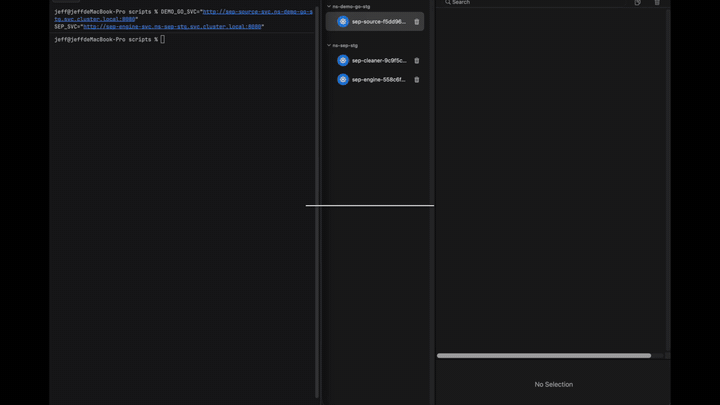
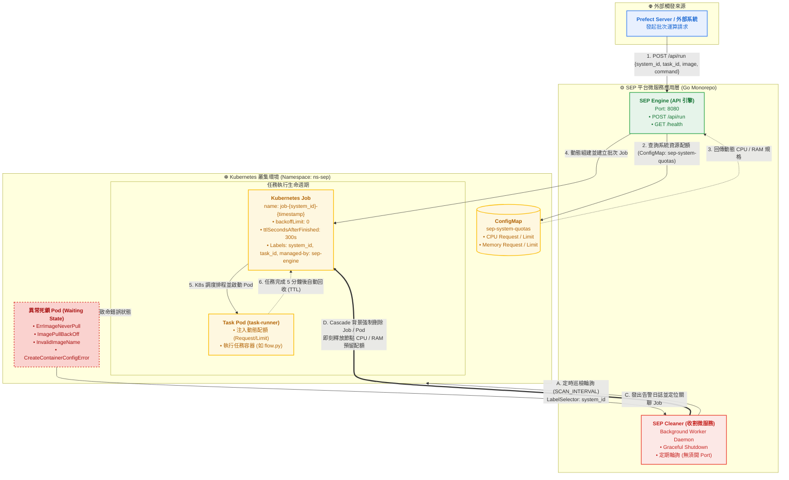
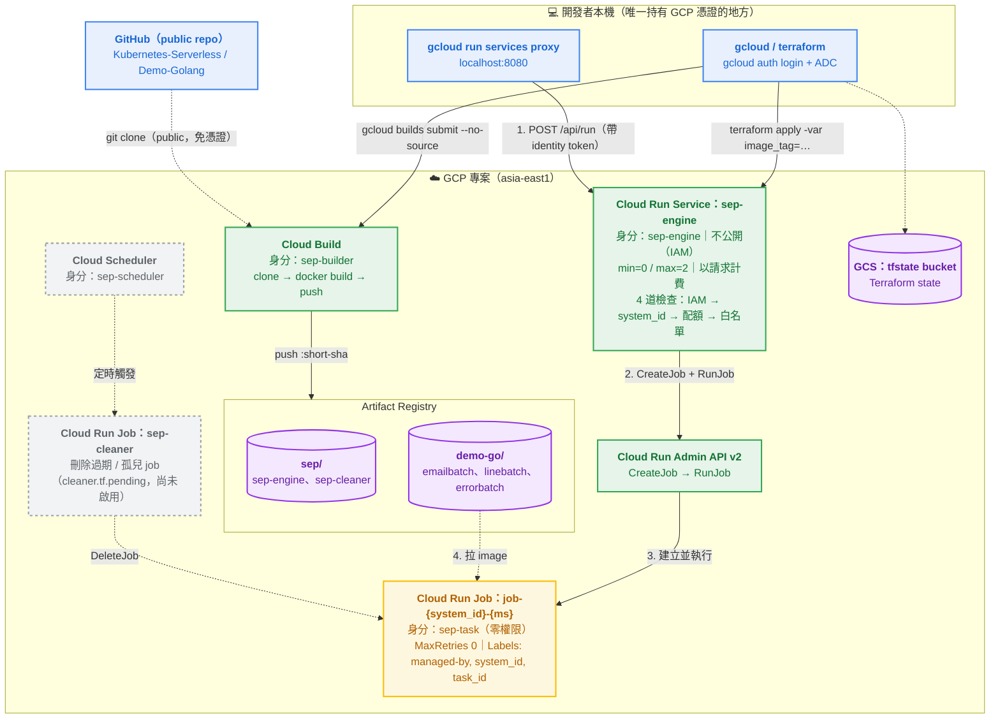

# SEP - Serverless Execution Platform (無伺服器執行平台)

**SEP (Serverless Execution Platform)** 是一個輕量的批次任務執行平台。系統接收來自 Prefect 或外部排程系統的任務請求（`POST /api/run`），動態建立隔離的批次 Job 執行，並由 Cleaner 負責回收異常或已結束的任務。

同一份 Go 程式碼支援兩種執行平台，由環境變數 `PLATFORM` 切換：

| | **Kubernetes 版**（`PLATFORM=k8s`，預設） | **GCP Cloud Run 版**（`PLATFORM=cloudrun`） |
|---|---|---|
| 任務跑在哪 | K8s Job → Pod | Cloud Run Job → Task |
| 適合情境 | 已有叢集、本機 OrbStack 開發 | 不想養叢集，閒置零成本、落在免費額度內 |
| 部署方式 | Helm + 部署腳本 | Terraform + Cloud Build（手動觸發） |
| 說明章節 | [Part A](#part-akubernetes-版) | [Part B](#part-bgcp-cloud-run-版) |

> **參考實作（來源系統）**：[Demo-Golang](https://github.com/JeffLin0225/Demo-Golang)，一個實際接入 SEP 的來源系統，
> 完整實作了下方「[來源系統接入規範](#來源系統接入規範source-system-integration-spec)」要求的 immutable tag 與版本閘門機制，
> 兩種平台都已驗證可用。可作為新系統接入時的對照範本。

---

[](https://pub-05c62739ac6f4499a3401b26d0e9faaf.r2.dev/img/serverless/sep-runtime.html)

> 獨立單檔 HTML（內嵌 SVG，支援深/淺色主題與匯出），託管於 CDN。圖中呈現 K8s 版的 9 個核心元件、一條主鏈路（Caller → Service → Engine → K8s API → Job → Pod）、外部依賴（Prefect 呼叫端、GHCR Image Registry）與叢集信任邊界，Cleaner 收割迴圈與交付流程以卡片補充說明。

---

## 實作展示

[-blue?style=for-the-badge&logo=youtube)](https://pub-05c62739ac6f4499a3401b26d0e9faaf.r2.dev/video/SEP-video.mp4)



---

## 目錄

- [平台切換的設計](#平台切換的設計)
- [專案結構](#專案結構)
- [API 規格](#api-規格)
- [Part A：Kubernetes 版](#part-akubernetes-版)
- [Part B：GCP Cloud Run 版](#part-bgcp-cloud-run-版)
- [來源系統接入規範](#來源系統接入規範source-system-integration-spec)

---

## 平台切換的設計

Engine 和 Cleaner 啟動時讀一次 `PLATFORM`，決定要用哪一套實作，之後每個請求都走同一套：

```go
// services/engine/main.go
switch cfg.Platform {
case "cloudrun":
    launcher = service.NewCloudRunLauncher(...)   // cloudrun_launcher.go
case "k8s":
    launcher = service.NewJobLauncher(...)        // k8s_launcher.go
default:
    log.Fatalf("不支援的 PLATFORM ...")            // 打錯字直接啟動失敗，不會默默跑錯平台
}
r := router.SetupRouter(launcher)
```

兩個 launcher 都實作同一個介面 `Launcher.Launch(ctx, req)`（`services/engine/service/launcher.go`），controller 只呼叫介面，不知道底下是哪個平台：

| | `k8s_launcher.go` | `cloudrun_launcher.go` |
|---|---|---|
| 建立任務 | `BatchV1().Jobs(ns).Create()`，建立即執行 | `CreateJob()`（只是定義）→ `RunJob()`（觸發一次 execution） |
| 配額來源 | 每次請求即時讀 ConfigMap `sep-system-quotas` | 啟動時讀一次環境變數 `SYSTEM_QUOTAS_JSON` |
| Image 檢查 | 不檢查（信任呼叫端） | 白名單前綴比對，不符合回 400 |
| 任務身分 | Pod 的 ServiceAccount | 沒有任何權限的 GCP SA `sep-task` |

`PLATFORM` 沒設時預設為 `k8s`，所以原本的 K8s 部署不需要任何修改。

---

## 專案結構

```text
├── common/                        # 【跨服務共用層】
│   ├── config/config.go           # EngineConfig / CleanerConfig：從 .env 或環境變數載入設定（含 PLATFORM 與 Cloud Run 專用欄位）
│   ├── kube/client.go             # K8s Clientset，In-Cluster 優先，本機自動 Fallback 至 ~/.kube/config
│   └── model/
│       ├── run.go                 # RunRequest / RunResponse，含欄位驗證規則
│       └── labels.go              # 兩個平台共用的 label：managed-by、system_id、task_id
│
├── services/
│   ├── engine/                    # 【微服務 1】SEP API 引擎
│   │   ├── controller/            # health.go（GET /health）、run.go（POST /api/run，ErrRejected 回 400）
│   │   ├── router/router.go       # 路由註冊，注入 Launcher
│   │   ├── service/
│   │   │   ├── launcher.go        # Launcher 介面與 ErrRejected
│   │   │   ├── k8s_launcher.go    # K8s 版：讀 ConfigMap 配額、組 Job Spec、建立 Job
│   │   │   └── cloudrun_launcher.go # Cloud Run 版：驗證 system_id / 配額 / 白名單 → CreateJob → RunJob
│   │   ├── Dockerfile
│   │   └── main.go                # 依 PLATFORM 選擇 launcher，啟動 Gin Server
│   │
│   └── cleaner/                   # 【微服務 2】SEP Cleaner
│       ├── service/
│       │   ├── cleaner.go         # K8s 版：常駐輪詢，收割卡在不可逆錯誤的 Pod
│       │   └── cloudrun_cleaner.go # Cloud Run 版：掃描一次就結束，刪除過期 / 孤兒 job
│       ├── Dockerfile
│       └── main.go                # 依 PLATFORM 選擇實作，支援 Graceful Shutdown
│
├── charts/                        # 【K8s】Helm Chart（values.yaml + dev / stg / prod 覆蓋檔、templates/）
├── scripts/                       # 【K8s】deploy.sh、deploy_github.sh、update-quotas.sh
├── .github/workflows/CI-Build.yaml # 【K8s】手動觸發 CI：multi-arch build 並 push 至 GHCR
│
├── terraform/                     # 【Cloud Run】所有 GCP 基礎設施（見 Part B）
├── cloudbuild.yaml                # 【Cloud Run】Cloud Build：從 GitHub clone 並 build engine / cleaner
│
├── specs/                         # Cloud Run 版的實作規格與交接文件
├── test/                          # IDE HTTP Client 測試檔（GoLand / VS Code REST Client）
├── flow.py                        # Prefect Flow 範例
├── go.mod / go.sum                # Go Module（module: sep，Go 1.26）
└── sep-runtime.html               # 互動架構圖原始檔
```

---

## API 規格

兩個平台的 API 完全相同。

### 1. 健康檢查
```bash
curl http://localhost:8080/health
# {"message":"系統運行正常","status":"OK"}
```

### 2. 建立任務 Job
```bash
curl -s -X POST http://localhost:8080/api/run \
  -H "Content-Type: application/json" \
  -d '{
    "system_id": "crawler",
    "task_id": "flow-run-abc123",
    "namespace": "ns-sep",
    "image": "python:3.11-alpine",
    "command": ["python", "flow.py"]
  }'
```

**Request 欄位說明**

| 欄位 | 型別 | 必填 | 說明 |
|------|------|------|------|
| `system_id` | string | ✅ | 系統識別碼，需在配額表中註冊（max 40 字元）。Cloud Run 版只能是小寫英數和 `-` |
| `task_id` | string | ✅ | 任務唯一識別碼，如 Prefect flow_run_id（max 63 字元） |
| `namespace` | string | — | K8s 版的目標 Namespace（未填預設 `ns-sep`）。Cloud Run 版忽略此欄位 |
| `image` | string | ✅ | 要執行的容器 image。Cloud Run 版必須符合白名單前綴 |
| `command` | array | — | 覆蓋容器預設指令（如 `["python", "flow.py"]`，未填則使用 image 預設） |

**Response**

| 狀態碼 | 意思 |
|---|---|
| `200` | Job 已建立並開始執行。**不代表任務成功**，Engine 不等任務跑完，結果要到平台上看 |
| `400` | 請求格式錯誤，或請求被拒絕（系統未註冊、image 不在白名單），`error` 欄位會說明原因 |
| `500` | 建立 Job 時平台端出錯（權限不足等），詳細原因只寫在 Engine log，不回給呼叫端 |

```json
{
  "status": "ok",
  "message": "已成功接收 TaskID:flow-run-abc123",
  "job_name": "job-crawler-1787493682127"
}
```

Job 名稱格式固定為 `job-<system_id>-<建立時的毫秒時間戳>`。

---

# Part A：Kubernetes 版

## 系統架構



## 部署環境總覽

| 環境 | 執行方式 | Image 來源 | 部署方式 | 狀態 |
|------|---------|-----------|---------|------|
| **dev** | 本機直接執行 `go run`，**不容器化** | — | 無需部署腳本，直接跑 | ✅ 已完成 |
| **stg** | 容器化，部署至本機 K8s（OrbStack） | 本地 `docker build` 或 GHCR（CI 建置） | `scripts/deploy.sh`（本地build+CD）或 `scripts/deploy_github.sh`（拉 GHCR image+CD） | ✅ 已完成 |
| **prod** | 容器化，目標全自動化 GitOps | GHCR（multi-arch, immutable tag） | ArgoCD 自動同步部署 | 🚧 規劃中，尚未實作（目前僅有 `charts/prod/values.yaml` 設定骨架） |

三種環境對應三種不同成熟度的 CI/CD 思路，詳見下方「Kubernetes 叢集部署」與「CI/CD 流程」章節。Cloud Run 版的部署見 [Part B](#part-bgcp-cloud-run-版)。

## 事前準備

### 必要環境
- Go 1.26+
- kubectl、Helm
- OrbStack / Docker Desktop（或其他 K8s 叢集）

### 確認 K8s 叢集連線
```bash
kubectl config current-context
# 預期輸出：orbstack (或 docker-desktop / minikube)
```

### 建立 Namespace 並套用系統配額
```bash
# 確保 namespace 存在
kubectl create namespace ns-sep --dry-run=client -o yaml | kubectl apply -f -
kubectl create namespace ns-sep-stg --dry-run=client -o yaml | kubectl apply -f -

# 配額定義在 charts/values.yaml，只渲染並套用 sep-system-quotas 這個 ConfigMap
./scripts/update-quotas.sh stg

# 確認套用成功
kubectl get configmap sep-system-quotas -n ns-sep-stg
```

### 配置 Kubernetes RBAC 權限（重要）
當 SEP Engine 部署在 K8s 叢集內部時，需要權限存取 ConfigMap 與動態建立 Job。需為對應 Namespace 的 ServiceAccount 授權：

```bash
# 選項 A：全叢集授權（推薦本機開發 / Staging 跨環境測試）
kubectl create clusterrolebinding sep-engine-stg-global-admin \
  --clusterrole=admin \
  --serviceaccount=ns-sep-stg:default

# 選項 B：單一 Namespace 隔離授權（符合最小權限規範）
kubectl create rolebinding default-admin \
  --clusterrole=admin \
  --serviceaccount=ns-sep-stg:default \
  -n ns-sep-stg
```
> **原理**：Pod 預設以 `default` ServiceAccount 運行。未授權時存取 K8s API 會引發 `403 Forbidden`。

## 本機啟動

### 1. 啟動 SEP API 引擎（主要服務）
```bash
go run ./services/engine
```
啟動成功後會看到：
```
[INFO] 非 In-Cluster 環境，改用 ~/.kube/config 連線（本機開發模式）
🚀 [Engine] 服務啟動於 Port: 8080（平台: k8s）
```

### 2. 啟動 SEP Pod Cleaner 異常收割監控服務（背景微服務）
```bash
go run ./services/cleaner
```
啟動成功後會看到：
```
[INFO] 正在初始化 Cleaner 微服務...
[INFO] 非 In-Cluster 環境，改用 ~/.kube/config 連線（本機開發模式）
🚀 [Cleaner] 異常 Pod 收割微服務啟動，巡檢週期: 5s, 目標 Namespace: 'ns-sep' (空字串代表全叢集)
```

> **注意**：Cleaner 為純背景 Worker，不需要開任何 Port，無需建立 K8s Service 或 Ingress。

## Kubernetes 叢集部署（Helm 模式）

專案提供兩種部署腳本，皆整合了 ConfigMap 同步、Helm 渲染部署與 Deployment 優雅重啟，差別在於 **Image 從哪裡來**：

### 方式 A：`scripts/deploy.sh`（本地 build，本地部署）
不依賴 GitHub Actions，直接在本機 `docker build` 後部署，適合本機開發時快速迭代驗證：

```bash
# 基本部署：同步 .env 至 ConfigMap 並執行 Helm upgrade/install
./scripts/deploy.sh stg

# 完整部署：包含本地 Docker Image 重新打包 (改動 Go 程式碼時使用)
./scripts/deploy.sh stg --build
```

### 方式 B：`scripts/deploy_github.sh`（拉取 GHCR image，本地部署）
Image 由 GitHub Actions（`CI-Build.yaml`）建置並 push 到 GHCR，本機只負責 `docker pull` + Helm 部署，**不會有任何雲端 CD 連進本機**，部署動作永遠是手動在本機觸發：

```bash
# 自動抓 origin/stg 最新 commit 的 SHA 去 GHCR 拉對應 image
./scripts/deploy_github.sh stg

# 指定特定 SHA 版本部署（例如要回滾到舊版本）
./scripts/deploy_github.sh stg 7d8e7d7e8a33fa60abaafc17d2fe1fd63d56a15e

# prod 對應 CI 的 main 分支（目前僅腳本邏輯支援，叢集尚未實際上 prod）
./scripts/deploy_github.sh prod
```

> **注意**：`scripts/deploy_github.sh` 目前只支援 `stg` / `prod`（對應 CI-Build.yaml 的 `stg` / `main` 分支）。`dev` 環境本機直接 `go run`，不透過容器部署，也不適用此腳本。
> 詳細的 CI 建置與版本對應規則見下方「CI/CD 流程」章節。

### 方式 C：`scripts/update-quotas.sh`（只更新配額，不 build 不 deploy）
只改 `quotas.systems`（新增/調整來源系統配額）時使用，只會渲染並套用 `sep-system-quotas` 這個 ConfigMap，**不會 build image、不會跑完整 helm upgrade、也不會 rollout restart**。原因是 engine 在收到請求當下才即時向 K8s API 讀取這個 ConfigMap（見下方「系統配額管理」），所以改完 ConfigMap 對下一個請求立刻生效：

```bash
./scripts/update-quotas.sh stg
```

### 服務發現與固定入口（Service 架構）
為了解決 Pod 重啟 / 滾動更新時動態 IP 變動的問題，架構在 Engine 前方配置了 Kubernetes Service（`sep-engine-svc`，類型預設為 `LoadBalancer`）：

```text
[外部呼叫端 / Prefect]
       │
       ▼ (固定門牌 IP / 網域名稱)
[Kubernetes Service: sep-engine-svc]
       │
       ├─► 負載均衡分流至 Engine Pod 1
       └─► 負載均衡分流至 Engine Pod 2
```

**連線與測試管道：**
- **OrbStack 外部 IP 直連**：`kubectl get svc -n ns-sep-stg` 取得 `EXTERNAL-IP`（如 `http://192.168.139.2:8080`）。
- **K8s 叢集內部 CoreDNS**：內部微服務可直接存取 `http://sep-engine-svc:8080` 或完整 FQDN `http://sep-engine-svc.ns-sep-stg.svc.cluster.local:8080`。
- **本地域名模擬 (/etc/hosts)**：
  ```bash
  echo "192.168.139.2  sep.local" | sudo tee -a /etc/hosts
  curl http://sep.local:8080/health
  ```
- **本機 Port-Forward 穩定連線**：
  ```bash
  kubectl port-forward -n ns-sep-stg svc/sep-engine-svc 8080:8080
  curl http://localhost:8080/health
  ```

## CI/CD 流程（GitHub Actions → GHCR）

SEP 自身（engine / cleaner）的建置與部署，目前是 **CI 自動化、CD 手動本機觸發** 的組合：GitHub Actions 只負責建置與推送 image，完全不會連進本機或叢集操作任何資源；實際部署一律由開發者在本機手動執行 `scripts/deploy_github.sh`。

### 1. 觸發建置
`.github/workflows/CI-Build.yaml` 是 `workflow_dispatch`（手動觸發，**不會**在 push 時自動執行），到 GitHub Actions 頁面手動選擇分支執行：

```
Actions → (Choose Branch) Build and Push Branch → Run workflow → 選擇 branch
```

建置完成後會同時 push 兩個 image（**multi-arch：linux/amd64 + linux/arm64**，同時支援 Intel/Cloud 環境與 Apple Silicon 本機）：

```
ghcr.io/jefflin0225/<branch>/sep-engine:<git-sha>
ghcr.io/jefflin0225/<branch>/sep-cleaner:<git-sha>
```

### 2. 分支與部署環境的對應關係（重要）

| 觸發 CI 時選的 branch | 部署環境 | 指令 |
|---|---|---|
| `stg` | stg | `./scripts/deploy_github.sh stg` |
| `main` | prod（規劃中） | `./scripts/deploy_github.sh prod` |

**觸發 CI 時選的 branch，必須跟要部署的環境一致**——branch 同時決定了「編譯哪個版本的原始碼」與「GHCR image tag 的路徑前綴」。選錯 branch（例如要部署 stg 卻選了 main）會導致 `scripts/deploy_github.sh` 去抓的 GHCR 路徑跟 SHA 完全對不上，pull 時會出現 `not found`。

### 3. Multi-arch 建置與跨平台編譯優化
`CI-Build.yaml` 使用 `docker/setup-qemu-action` + `docker/setup-buildx-action`，讓 amd64 runner 也能建出 arm64 image。為了避免 Go 編譯這種吃 CPU 的步驟被 QEMU 模擬拖慢（emulated 編譯可能慢 5~20 倍），兩個 Dockerfile 的 builder stage 都用 `--platform=$BUILDPLATFORM` 固定在 runner 原生架構上執行，改用 Go 原生跨平台編譯（`GOOS=$TARGETOS GOARCH=$TARGETARCH`）產生目標架構的執行檔，只有最後複製檔案的 runtime stage 才切換架構：

```dockerfile
FROM --platform=$BUILDPLATFORM golang:1.26-alpine AS builder
...
ARG TARGETOS
ARG TARGETARCH
RUN CGO_ENABLED=0 GOOS=$TARGETOS GOARCH=$TARGETARCH go build -o /app/engine-bin ./services/engine
```

### 4. GHCR 存取權限
若 `docker pull` 出現 `unauthorized` / `denied`，代表 GHCR package 為 private，需先 `docker login ghcr.io -u <github帳號>`（用有 `read:packages` 權限的 PAT）；若是 `not found`，通常是該 SHA 還沒手動觸發過 CI 建置（見上方分支對應規則）。

### 5. Roadmap：prod 走 ArgoCD 全自動化 GitOps
目前 `stg` 的 CD（`helm upgrade`）仍是本機手動執行，`prod` 環境規劃導入 **ArgoCD**，改為標準 GitOps 流程（Git 上的 Helm values 變更 → ArgoCD 自動偵測並同步部署），屆時 CI 建置完成後只需更新 `charts/prod/values.yaml` 的 image tag 並 push，部署即可自動完成，不再需要手動跑部署腳本。此項目尚未實作，目前僅有 `charts/prod/values.yaml` 設定骨架。

## 系統配額管理

配額設定在 Helm `charts/values.yaml`（可被 `charts/<env>/values.yaml` 疊加/覆蓋，同名系統以 env 檔為準，其餘系統仍會保留），每個系統需定義 4 個 key：

```yaml
# 格式：<system_id>.<resource>
crawler.cpu_request: "250m"
crawler.memory_request: "512Mi"
crawler.cpu_limit: "500m"
crawler.memory_limit: "1Gi"
```

目前支援的系統：`crawler` / `reporting` / `analytics` / `demo-go`。新增系統時在 yaml 加入對應配額後，執行 `./scripts/update-quotas.sh <env>` 套用即可——不需要 build、也不需要重新部署或 rollout restart，詳見「Kubernetes 叢集部署」章節的方式 C。

## 常用維運指令

### 1. 服務與網路診斷（Service & Pod IP）
```bash
# 查詢 Pod 運行節點與內部 IP（-o wide）
kubectl get pods -n ns-sep-stg -o wide

# 查詢 Service 門牌與分配之 LoadBalancer External-IP
kubectl get svc -n ns-sep-stg

# 【實用】利用標籤一次打包查詢 Engine 家族所有元件 (Pod, Svc, Deployment, ReplicaSet, ConfigMap)
kubectl get all,cm -n ns-sep-stg -l app=sep-engine

# 驗證 K8s 內部 CoreDNS 解析與 Service 轉發（啟動臨時容器測試）
kubectl run test-dns --rm -it --image=curlimages/curl --restart=Never -n ns-sep-stg \
  -- curl -s http://sep-engine-svc:8080/health
```

### 2. 任務 Job 與 Pod 生命週期查詢
```bash
# 查看 SEP 配額 ConfigMap
kubectl get configmap sep-system-quotas -n ns-sep-stg

# 查看目前由 SEP Engine 建立的 Job 與 Pod（以 system_id 標籤篩選）
kubectl get jobs -n ns-sep-stg -l system_id
kubectl get pods -n ns-sep-stg -l system_id

# 將 system_id / task_id 展開為獨立欄位顯示（一目瞭然）
kubectl get pods -n ns-sep-stg -L system_id,task_id

# 針對特定系統或任務查詢
kubectl get pods -n ns-sep-stg -l system_id=crawler
kubectl get pods -n ns-sep-stg -l task_id=flow-run-test-001

# 一鍵清除所有 Engine 管理的 Job（Cleaner 通常會自動處理，手動清除時使用）
kubectl delete jobs -n ns-sep-stg -l system_id

# 查看 Pod 詳細資訊與即時 Log
kubectl describe pod <pod-name> -n ns-sep-stg
kubectl logs -f <pod-name> -n ns-sep-stg
```

### 3. RBAC 權限維護
```bash
# 賦予 default 帳號跨 Namespace 最高管理權限（開發模式通用）
kubectl create clusterrolebinding sep-engine-stg-global-admin \
  --clusterrole=admin \
  --serviceaccount=ns-sep-stg:default

# 查詢當前 RoleBinding 狀態
kubectl get rolebinding,clusterrolebinding | grep sep-engine
```

## 環境變數（K8s 版）

### Engine（`services/engine/.env` 或根目錄 `.env`）

| 變數 | 說明 | 預設 |
|------|------|------|
| `PLATFORM` | 執行平台（`k8s` / `cloudrun`） | `k8s` |
| `NAMESPACE` | 管理配額 ConfigMap 與 Job 所在的 Namespace | `ns-sep` |
| `PORT` | 服務監聽 Port | `8080` |
| `IMAGE_PULL_POLICY` | Image 拉取策略（`Always` / `IfNotPresent` / `Never`） | `Never` |
| `SYSTEM_QUOTAS_CONFIGMAP` | 配額 ConfigMap 名稱 | `sep-system-quotas` |
| `GIN_MODE` | Gin 模式（`debug` / `release`） | `debug` |

### Cleaner（`services/cleaner/.env`）

| 變數 | 說明 | 預設 |
|------|------|------|
| `PLATFORM` | 執行平台（`k8s` / `cloudrun`） | `k8s` |
| `TARGET_NAMESPACE` | 監控目標 Namespace（空字串代表跨全叢集監控） | `ns-sep` |
| `SCAN_INTERVAL` | 異常 Pod 巡檢週期，需帶單位（如 `5s`、`30s`、`1m`） | `5s` |
| `NORMAL_WAITING_REASONS` | 視為正常的 Waiting 狀態（逗號分隔），其餘一律視為異常 | `ContainerCreating,PodInitializing` |

---

# Part B：GCP Cloud Run 版

> 分支 `dev-GcpCloudRun`。目標是不養 K8s 叢集，並且**完全落在 GCP 免費額度內**。

## 系統架構



## 與 K8s 版的對照

| K8s 版 | Cloud Run 版 |
|---|---|
| Engine Deployment + Service | Cloud Run Service `sep-engine`（不公開、min=0、以請求計費） |
| Cleaner Deployment（常駐輪詢） | Cloud Run Job `sep-cleaner` + Cloud Scheduler 定時觸發，跑一次就結束 |
| ConfigMap `sep-system-quotas` | `terraform.tfvars` → 環境變數 `SYSTEM_QUOTAS_JSON` |
| （無） | Image 白名單：`terraform.tfvars` → 環境變數 `ALLOWED_IMAGE_PREFIXES` |
| `BatchV1().Jobs().Create()` | Cloud Run Admin API v2：`CreateJob` 之後 `RunJob` |
| `ttlSecondsAfterFinished: 300` | Cloud Run Job 沒有 TTL，由 Cleaner 刪除跑完的 job |
| 收割 `ImagePullBackOff` 的 Pod | 不需要：Cloud Run 沒有 Pending 狀態，image 讀不到時 `CreateJob` 當下就失敗（權限不足已實測；image 不存在的情況尚未實測） |
| ServiceAccount + RBAC | GCP Service Account + IAM |
| Helm values（dev / stg / prod） | `terraform.tfvars` |
| GitHub Actions → GHCR | `gcloud builds submit`（Cloud Build）→ Artifact Registry |

## 設計決策

| 項目 | 決策 | 原因 |
|---|---|---|
| CI/CD | 手動執行兩個指令（build、apply），不設 trigger | repo 是公開的，GitHub 和 GCP 之間**不建立任何連線**：沒有 SA key、沒有 WIF、沒有 Cloud Build GitHub 連線 |
| 憑證 | 只存在本機（`gcloud auth login` + ADC） | 沒有可外洩的金鑰 |
| Image 建置 | Cloud Build 自己從 GitHub clone public repo | 不上傳本機原始碼，build 的一定是 GitHub 上的版本；Mac 是 arm64，Cloud Run 要 amd64 |
| Image tag | git short sha（immutable） | 可追溯到 commit、不會被覆蓋、可回滾 |
| Engine 對外 | 不公開，**不給** `allUsers` / `allAuthenticatedUsers` 任何權限 | 自己用時透過 `gcloud run services proxy` |
| 基礎設施 | Terraform，state 放 GCS | `plan` 先看差異、`destroy` 一行清乾淨 |
| 任務 job | Engine 執行期呼叫 API 建立，**不進 Terraform** | Terraform 只管固定的基礎設施 |
| Image 存放 | 每個來源系統一個 Artifact Registry repo | 各系統的 image、cleanup policy、權限分開管理 |
| 規則集中 | 配額表與白名單都只寫在 `terraform.tfvars` | 只有一個地方能決定「誰能跑什麼」 |

## 安全設計

### `/api/run` 的四道檢查

```
請求 ──► ① IAM（Cloud Run 前端）        沒有 run.invoker 權限 → 403（根本到不了 Engine）
     ──► ② system_id 格式               不是小寫英數和 "-" → 400
     ──► ③ 配額表 SYSTEM_QUOTAS_JSON     系統未註冊 → 400
     ──► ④ 白名單 ALLOWED_IMAGE_PREFIXES image 前綴不符 → 400
     ──► CreateJob → RunJob ──► 200
```

白名單是**前綴比對**，所以前綴結尾一定要有 `/`。少了 `/` 的話，`…/demo-go` 也會放行 `…/demo-go-evil/…`。

### 身分與權限（最小權限）

| Service Account | 誰用 | 權限 | 為什麼 |
|---|---|---|---|
| `sep-builder` | Cloud Build | 對 `sep`、`demo-go` repo 的 `artifactregistry.writer`；專案層級 `logging.logWriter` | 只能 push 到明確授權的 repo，不用預設的 Cloud Build 身分（Editor） |
| `sep-engine` | Engine 服務 | 專案層級 `run.developer`；對 `sep-task` 的 `iam.serviceAccountUser`；對系統 repo 的 `artifactregistry.reader` | 建立和執行 job；借用 `sep-task` 身分；`CreateJob` 時 GCP 會檢查呼叫者能否讀取該 image |
| `sep-task` | 每個任務 job | **沒有任何權限** | 任務跑的是外部傳入的 image，不能碰到 GCP 任何資源 |
| `sep-cleaner` | Cleaner job | 專案層級 `run.developer` | 列出和刪除 job |
| `sep-scheduler` | Cloud Scheduler | 只對 `sep-cleaner` 這一個 job 的 `run.invoker` | 只能觸發 Cleaner |

所有 IAM 都用 `_iam_member`（加一筆），不用 `_iam_policy` / `_iam_binding`（會覆蓋別人的權限）。

## 免費額度

所有額度以**帳單帳戶**為單位、每月重置。數字以 [Cloud Run pricing](https://cloud.google.com/run/pricing) 為準。

| 服務 | 免費額度 | 本專案用量 |
|---|---|---|
| Cloud Run Service（以請求計費） | 180,000 vCPU-秒、360,000 GiB-秒、200 萬次請求 | Engine 1 vCPU / 512Mi，約每月 50 小時的「處理請求中」時間；閒置縮到 0 不計費 |
| Cloud Run Jobs | 240,000 vCPU-秒、450,000 GiB-秒 | 任務 1 vCPU / 512Mi，約每月 66 小時執行時間；一次批次約 20~30 秒 |
| Cloud Build | 每月 2,500 build 分鐘（e2-standard-2） | 一次 build 約 2 分鐘 |
| Artifact Registry | 0.5 GB 儲存 | cleanup policy：超過 1 天的刪除，每個 image 名稱保留最新 3 版 |
| Cloud Scheduler | 3 個排程 | 只有 Cleaner 一個 |
| Cloud Storage | 5 GB（限美國部分 region） | tfstate bucket 放 `us-central1` |

注意事項：

- Engine 必須是**以請求計費**（`cpu_idle = true`）。`resources.limits` 有寫時，provider 預設是 `false`（以執行個體計費），`engine.tf` 明確設定了這一項。
- Job 的定義本身不收費，只有執行時才計費。但 Cloud Run Job 不會自動刪除，數量有上限，這是 Cleaner 存在的原因。
- 專案設有 Budget 告警（只寄信通知，**不會**自動停止計費）。

## Terraform 檔案一覽

| 檔案 | 內容 |
|---|---|
| `main.tf` | `terraform {}`（版本限制）、`provider "google"`、`locals`（`repo_url`、`allowed_image_prefixes`） |
| `backend.tf` | state 存在 GCS（bucket 用 `-backend-config` 傳入，不寫死在檔案裡） |
| `variables.tf` | 變數**宣告**（型別、說明、預設值） |
| `terraform.tfvars` | 變數的**值**：Project ID、配額表、白名單。**不進 git**（含 Project ID） |
| `terraform.tfvars.example` | `terraform.tfvars` 的範本，進 git。tfvars 的結構有變時要同步更新 |
| `artifact_registry.tf` | `sep` repo（平台自己）、`demo-go` repo（來源系統），含 cleanup policy |
| `build.tf` | `sep-builder` SA 與它的寫入 / log 權限 |
| `iam.tf` | 執行期的 4 個 SA（engine、cleaner、task、scheduler）與 Engine 的權限 |
| `engine.tf` | `image_tag` 變數、Cloud Run Service `sep-engine` |
| `outputs.tf` | `engine_url`、`repo_url`、`builder_service_account` |
| `cleaner.tf.pending` | Cleaner job、Scheduler 與其權限。**尚未啟用**，拿掉 `.pending` 即可 |

`variables.tf` 和 `terraform.tfvars` 的關係，類似 Helm 的 `charts/values.yaml`（定義有哪些設定）和 `charts/<env>/values.yaml`（這個環境實際的值）。

## 一次性準備

只有第一次建環境時需要。

```bash
# 1. 設定專案
gcloud config set project <PROJECT_ID>
export PROJECT_ID=$(gcloud config get-value project)

# 2. 開啟需要的 API
gcloud services enable run.googleapis.com cloudbuild.googleapis.com \
  artifactregistry.googleapis.com cloudscheduler.googleapis.com \
  iam.googleapis.com cloudresourcemanager.googleapis.com

# 3. 建立 Terraform state bucket（us-central1 才有免費額度），並開啟版本控制
gcloud storage buckets create gs://$PROJECT_ID-tfstate --location=us-central1 --uniform-bucket-level-access
gcloud storage buckets update gs://$PROJECT_ID-tfstate --versioning

# 4. 讓 Terraform 使用你的身分（同意頁要勾選所有權限）
gcloud auth application-default login

# 5. 建議：在 Console 的「帳單 → 預算與快訊」設定 Budget 告警

# 6. 準備變數檔並初始化
cd terraform
cp terraform.tfvars.example terraform.tfvars   # 填入 project_id
terraform init -backend-config="bucket=$PROJECT_ID-tfstate"
```

### 第一次部署的順序

Cloud Run Service 建立時 image 必須已經存在，而 image 要先有 Artifact Registry 才能 push，所以第一次要分兩段：

1. 暫時把 `engine.tf`、`outputs.tf` 改名為 `.pending`，`terraform apply` 先建 repo、SA、權限。
2. `gcloud builds submit` build 出第一個 image。
3. 把 `.pending` 拿掉，`terraform apply -var image_tag=<sha>` 建立 Engine。

之後的部署就不需要這樣分段。

## 日常部署

### 更新 Engine / Cleaner（改了 Go 程式碼）

```bash
# 0. 程式碼要先 push：Cloud Build 是從 GitHub clone，不是讀本機
git push

# 1. build：Cloud Build clone 指定分支最新的 commit，image tag = short sha
export PROJECT_ID=$(gcloud config get-value project)
gcloud builds submit --no-source --config cloudbuild.yaml \
  --service-account "projects/$PROJECT_ID/serviceAccounts/sep-builder@$PROJECT_ID.iam.gserviceaccount.com" \
  --substitutions _BRANCH=main

# 2. 部署：用剛剛 build 出來的 sha
cd terraform
terraform plan  -var image_tag=<short-sha>
terraform apply -var image_tag=<short-sha>
```

- `<short-sha>` 可以在 Cloud Build log 的 `build commit: xxxxxxx` 看到，或在 Artifact Registry 的「標記」欄。
- `apply` 會產生新 revision。新 revision 通過 startup probe（`/health`）後，流量才 100% 切過去；沒通過就維持舊 revision。舊 revision 上處理中的請求會先完成。
- 回滾：`terraform apply -var image_tag=<舊的 sha>`（cleanup policy 保留最新 3 版）。

### 只改設定（配額、白名單）

改 `terraform/terraform.tfvars` 後 apply，`image_tag` 沿用目前的版本：

```bash
terraform apply -var image_tag=<目前的 sha>
```

Go 程式只在**啟動時**讀環境變數，所以改設定一樣會產生新 revision（不中斷服務）。

| 改了什麼 | 要 build 嗎 | apply 用的 tag |
|---|---|---|
| `terraform.tfvars` / `.tf` | 不用 | 沿用目前的 |
| Go 程式碼 | 要 | 新的 sha |

## 呼叫 Engine

Engine 不公開，直接 curl 網址會得到 Google Frontend 的 `403`。

```bash
# 終端機 A：開 proxy（不要關），它會用你的 gcloud 身分加上 identity token 轉發
gcloud run services proxy sep-engine --region asia-east1 --port 8080

# 終端機 B
curl localhost:8080/health
curl -i -X POST localhost:8080/api/run \
  -H 'Content-Type: application/json' \
  -d '{"system_id":"demo-go","task_id":"email-001","image":"asia-east1-docker.pkg.dev/<PROJECT_ID>/demo-go/emailbatch:<sha>"}'
```

不想開 proxy 時，也可以直接帶 token：

```bash
curl -H "Authorization: Bearer $(gcloud auth print-identity-token)" https://<engine_url>/health
```

`engine_url` 在 `terraform output` 裡。

### 測試用的公開 image

自己的 repo 還沒有任務 image 時，可以用 Google 官方的範例 job（印幾行 log 就結束）。先把前綴加進白名單：

```hcl
extra_allowed_image_prefixes = ["us-docker.pkg.dev/cloudrun/container/"]
```

image 填 `us-docker.pkg.dev/cloudrun/container/job:latest`。測完記得從白名單移除。

## 新增一個來源系統

以 `demo-go` 為例，總共要改 **4 個地方**，全部都在 `terraform/`：

```
新系統 <sys>
├── 1. artifact_registry.tf  新增 repo "<sys>"（cleanup policy 照抄）
├── 2. build.tf              sep-builder → 該 repo 的 artifactregistry.writer   （讓 Cloud Build 能 push）
├── 3. iam.tf                sep-engine  → 該 repo 的 artifactregistry.reader   （讓 Engine 能用它建 job）
└── 4. terraform.tfvars      system_quotas 加入 <sys>；extra_allowed_image_prefixes 加入該 repo 前綴
```

```hcl
# terraform.tfvars
system_quotas = {
  demo-go = {
    cpu    = "1"
    memory = "512Mi"
  }
}

extra_allowed_image_prefixes = [
  "asia-east1-docker.pkg.dev/<PROJECT_ID>/demo-go/",
]
```

然後 `terraform apply -var image_tag=<目前的 sha>`。

來源系統那一邊，在自己的 repo 放一份 `cloudbuild.yaml`（可參考 [Demo-Golang 的 cloudbuild.yaml](https://github.com/JeffLin0225/Demo-Golang/blob/main/cloudbuild.yaml)），把 `_REPO` 設成自己的 repo 名稱：

```bash
# 在來源系統的 repo 目錄下
gcloud builds submit --no-source --config cloudbuild.yaml \
  --service-account "projects/$PROJECT_ID/serviceAccounts/sep-builder@$PROJECT_ID.iam.gserviceaccount.com"
```

> 白名單是全域的（任何已註冊系統都能跑任何白名單內的 image）。目前只有 Engine 會跨 repo 取用 image，各系統之間不會互相引用，所以先維持這個設計。之後若要「系統 A 只能跑 A 的 repo」，可以在 `system_quotas` 每個系統加上 `image_prefix` 欄位，並在 Go 依 `system_id` 檢查。

## Cleaner（尚未啟用）

Cloud Run Job 跑完不會自己消失，每呼叫一次 `/api/run` 就多一個 job。`cloudrun_cleaner.go` 的判斷：

| job 狀態 | 處理 |
|---|---|
| 沒有 `managed-by=sep-engine` label（例如 `sep-cleaner` 自己） | 不碰 |
| 從未執行過（`CreateJob` 成功但 `RunJob` 失敗留下的孤兒），且建立超過保留時間 | 刪除 |
| 執行中 | 跳過 |
| 已結束（不論成功或失敗），且結束超過保留時間 | 刪除 |

保留時間由 `job_retention`（預設 `5m`）控制，排程由 `cleaner_schedule`（預設每小時整點，`Asia/Taipei`）控制。

啟用方式：

```bash
cd terraform
mv cleaner.tf.pending cleaner.tf
terraform plan  -var image_tag=<sha>   # sep-cleaner image 需要已經 build 過同一個 sha
terraform apply -var image_tag=<sha>
```

## 常用指令

```bash
# 服務與 revision
gcloud run services describe sep-engine --region asia-east1
gcloud run revisions list --service sep-engine --region asia-east1
gcloud run services logs read sep-engine --region asia-east1 --limit 30

# 任務 job
gcloud run jobs list --region asia-east1
gcloud run jobs executions list --region asia-east1
gcloud run jobs delete <job-name> --region asia-east1

# image
gcloud artifacts repositories list --location asia-east1
gcloud artifacts docker images list asia-east1-docker.pkg.dev/$PROJECT_ID/demo-go --include-tags

# build 紀錄
gcloud builds list --limit 5

# Terraform
terraform output
terraform state list
```

在 Console 上：**Cloud Run** 的「服務」分頁是 Engine，「工作」分頁是任務 job。Job → Execution → Task 三層，點 execution 可以看 log 和成功 / 失敗狀態。

## 疑難排解

| 現象 | 原因 | 處理 |
|---|---|---|
| `Invalid bucket name: '-tfstate'`、`serviceAccounts/sep-builder@.iam...`、Cloud Build `INVALID_ARGUMENT` | `$PROJECT_ID` 是空的（開新終端機後 `export` 會消失） | `export PROJECT_ID=$(gcloud config get-value project)` |
| `gcloud builds submit` 被拒絕，要求設定 logging | 指定自訂 SA 時必須指定 log 去向 | `cloudbuild.yaml` 要有 `options.logging: CLOUD_LOGGING_ONLY` |
| `gcloud builds submit` 終端機沒印出 log | 同上，log 只寫到 Cloud Logging | 到 Console 的 Cloud Build 紀錄看，或用 `gcloud beta builds submit` |
| 直接 curl Engine 得到 `403`（`Server: Google Frontend`） | Engine 不公開，請求在 IAM 就被擋下 | 用 `gcloud run services proxy` 或帶 identity token |
| `/api/run` 回 `400` 未在配額表註冊 / 不在白名單 | tfvars 沒加，或加了但沒 apply | 修改 tfvars 後 `terraform apply` |
| `/api/run` 回 `500`，log 寫 `Permission 'artifactregistry.repositories.downloadArtifacts' denied` | `CreateJob` 時 GCP 會檢查**呼叫者**（`sep-engine`）能否讀取該 image | 在 `iam.tf` 給 `sep-engine` 該 repo 的 `artifactregistry.reader`；IAM 生效可能要等 1~2 分鐘 |
| Cloud Build push 失敗 `denied` | `sep-builder` 沒有該 repo 的寫入權限 | 在 `build.tf` 加 `artifactregistry.writer` |
| Engine 計費模式顯示「以執行個體為依據」 | `cpu_idle` 沒設，provider 預設為 `false` | `resources { cpu_idle = true }` |
| build 出來的是舊程式 | 程式碼沒 push，Cloud Build clone 的是 GitHub 上的版本 | 先 `git push` 再 build |

## 環境變數（Cloud Run 版）

這些都由 Terraform 設定，不需要手動填。

### Engine（`engine.tf`）

| 變數 | 來源 | 說明 |
|---|---|---|
| `PLATFORM` | 固定 `cloudrun` | 選用 Cloud Run launcher |
| `GIN_MODE` | 固定 `release` | |
| `GCP_PROJECT` / `GCP_REGION` | `var.project_id` / `var.region` | CreateJob 的 parent：`projects/<p>/locations/<r>` |
| `TASK_SERVICE_ACCOUNT` | `sep-task` 的 email | 任務 job 的執行身分 |
| `SYSTEM_QUOTAS_JSON` | `jsonencode(var.system_quotas)` | 配額表，例如 `{"demo-go":{"cpu":"1","memory":"512Mi"}}` |
| `ALLOWED_IMAGE_PREFIXES` | `join(",", local.allowed_image_prefixes)` | 白名單，逗號分隔。自己的 `…/sep/` 一定在內，其餘來自 `extra_allowed_image_prefixes` |
| `PORT` | Cloud Run 自動注入 | 不能自己設 |

### Cleaner（`cleaner.tf.pending`）

| 變數 | 來源 | 說明 |
|---|---|---|
| `PLATFORM` | 固定 `cloudrun` | |
| `GCP_PROJECT` / `GCP_REGION` | `var.project_id` / `var.region` | 掃描範圍 |
| `JOB_RETENTION` | `var.job_retention` | 跑完後保留多久才刪除（Go duration，預設 `5m`） |

## 已驗證的行為

| 驗證項目 | 結果 |
|---|---|
| 直接 curl Engine 網址 | `403`，Engine 不公開 |
| 透過 proxy 呼叫 `/health` | `200` |
| Google 範例 image | job 建立並執行成功 |
| Demo-Golang `emailbatch` / `linebatch` | job 執行成功，log 正確 |
| Demo-Golang `errorbatch`（`log.Fatalf`） | `Container called exit(1)` → execution 標記失敗（`0/1 tasks were a success`），`MaxRetries 0` 不重試 |
| Engine 缺少系統 repo 的讀取權限 | `CreateJob` 直接失敗、API 回 500，不會留下卡住的 job |
| 改白名單後 apply | 產生新 revision，啟動 log 印出新的白名單，服務不中斷 |
| Cleaner | 尚未啟用，未驗證 |

---

# 來源系統接入規範（Source System Integration Spec）

> 本章節定義所有接入 SEP 的來源系統（如爬蟲、報表、分析等）在 CI/CD 流程與 Image 管理上必須遵守的設計規範。
> SEP Engine 只負責「接受請求、查配額、建 Job」，**「此刻該跑哪個版本」的責任在來源端**，而非 SEP。
> （Cloud Run 版另有 image 白名單，只限制「能跑哪些來源的 image」，不介入版本選擇。）
>
> **已接入的來源系統**：[Demo-Golang](https://github.com/JeffLin0225/Demo-Golang)（`system_id: demo-go`）——
> 本規範的實作範例，可直接參照其 `scripts/` 與 README 的 CI/CD 策略章節。詳見本章末「[參考實作](#參考實作demo-golang)」。

---

### 核心設計原則

```
SEP 的職責：接受請求、查配額、建 Job            ← 不變
來源端的職責：決定「此刻該跑哪個版本的 Image」   ← 由來源端自己管理
```

兩者職責分離，SEP 無需理解任何來源系統的 CI/CD 時程邏輯。

---

### 一、Image Tag 命名規範

#### ❌ 禁止使用 Mutable Tag

| 禁止 | 原因 |
|------|------|
| `:latest` | CI 推新 image 後立刻生效，觸發 race condition |
| `:main`、`:master`、`:dev` | 與分支綁定，同樣是 mutable，每次 push 都會覆蓋 |

#### ✅ 必須使用 Immutable Tag

推薦格式（由最佳到可接受）：

| 格式 | 範例 | 說明 |
|------|------|------|
| Git Commit SHA（推薦） | `myapp:git-a3f1c2d` | 最具可追溯性，能直接定位原始碼版本 |
| SHA + 日期時間 | `myapp:git-a3f1c2d-20260919-1045` | 兼顧可讀性與可追溯性 |
| Semantic Version | `myapp:v1.2.3` | 適合有正式版號管理的系統 |
| Image Digest | `myapp@sha256:abc123...` | 最嚴格的 immutable，推薦 Production 使用 |

Cloud Run 版的 `cloudbuild.yaml` 直接用 clone 下來那個 commit 的 short sha 當 tag（例如 `emailbatch:90fbf26`）。

**CI Pipeline 範例（GitHub Actions）：**
```yaml
# .github/workflows/ci.yml
- name: Build & Push Image
  env:
    GIT_SHA: ${{ github.sha }}
    BUILD_TIME: ${{ steps.date.outputs.date }}   # 格式：YYYYMMDD-HHmm
  run: |
    IMAGE_TAG="git-${GIT_SHA::7}-${BUILD_TIME}"
    docker build -t myapp:${IMAGE_TAG} .
    docker push myapp:${IMAGE_TAG}
    echo "IMAGE_TAG=${IMAGE_TAG}" >> $GITHUB_OUTPUT  # 傳給後續步驟
```

---

### 二、來源端 ConfigMap 設計（版本閘門）

來源系統需在自己的 Namespace 維護一個 ConfigMap，作為「**當前已上線（CD 完成）的 Image Tag**」的唯一來源。

#### ConfigMap 結構範例

```yaml
# source-system/k8s/app-config.yaml
apiVersion: v1
kind: ConfigMap
metadata:
  name: crawler-app-config        # 各系統自行命名，與 SEP 無關
  namespace: ns-crawler           # 來源系統自己的 Namespace
data:
  # SEP 接入版本閘門
  current_image: "myapp:git-a3f1c2d-20260919-1045"   # CD 完成後才更新此欄位

  # 可依需求加入其他設定（與 SEP 無關）
  env: "production"
  log_level: "info"
```

> **重要**：`current_image` 只在 **CD 完成後**才更新。CI 階段嚴禁修改此欄位。

---

### 三、CI / CD 各階段責任分工

```
┌─────────────────────────────────────────────────────────────────────┐
│                    來源系統 CI 階段（只做建置）                        │
│                                                                     │
│  1. 編譯 / 測試 / 掃描                                               │
│  2. docker build → push myapp:git-a3f1c2d-20260919-1045            │
│  3. ✅ 結束。ConfigMap 不動，Prefect 排程繼續跑舊版                    │
└─────────────────────────────────────────────────────────────────────┘
              ↓ （人工審核 / 自動 Gate 通過後才觸發）
┌─────────────────────────────────────────────────────────────────────┐
│                    來源系統 CD 階段（部署上線）                        │
│                                                                     │
│  1. 執行 DB Migration、環境設定變更等前置作業                          │
│  2. kubectl patch configmap crawler-app-config \                    │
│       --patch '{"data":{"current_image":"myapp:git-a3f1c2d-..."}}'  │
│  3. ✅ 結束。下一次 Prefect 觸發就會用新版 Image                       │
└─────────────────────────────────────────────────────────────────────┘
              ↓
┌─────────────────────────────────────────────────────────────────────┐
│               來源系統 排程觸發（Prefect / Cron 等）                  │
│                                                                     │
│  1. 從 ConfigMap 讀取 current_image                                  │
│  2. POST /api/run {                                                  │
│       "system_id": "crawler",                                       │
│       "task_id":   "flow-run-abc123",                               │
│       "image":     "myapp:git-a3f1c2d-20260919-1045",  ← 從 CM 讀   │
│       "command":   ["python", "flow.py"]                            │
│     }                                                               │
│  3. SEP Engine 建立 Job，跑的永遠是 CD 已驗證上線的版本               │
└─────────────────────────────────────────────────────────────────────┘
```

**Race Condition 防護時序：**

| 時間點 | 事件 | ConfigMap `current_image` | Job 跑的版本 |
|--------|------|--------------------------|-------------|
| T1 | CI 推 `git-new-xxx` | `git-old-aaa`（未動） | `git-old-aaa` ✅ |
| T2 | Prefect 觸發排程 | `git-old-aaa` | `git-old-aaa` ✅（不受影響）|
| T3 | CD 完成，更新 CM | `git-new-xxx` | — |
| T4 | 下次 Prefect 觸發 | `git-new-xxx` | `git-new-xxx` ✅ |

CI 今天做、明天才 CD？沒問題，ConfigMap 不依時程，隨時 CD 都安全。

---

### 四、Prefect Flow 讀取 ConfigMap 範例

```python
# flow.py（Prefect 觸發端）
from prefect import flow
from kubernetes import client, config

def get_current_image(namespace: str, cm_name: str, key: str = "current_image") -> str:
    """從來源系統自己的 ConfigMap 取得當前已上線的 Image Tag"""
    config.load_incluster_config()   # K8s 叢集內部使用 in-cluster config
    v1 = client.CoreV1Api()
    cm = v1.read_namespaced_config_map(name=cm_name, namespace=namespace)
    return cm.data[key]

@flow
def trigger_sep_job():
    image = get_current_image("ns-crawler", "crawler-app-config")
    # image = "myapp:git-a3f1c2d-20260919-1045"（CD 完成後的版本）

    response = requests.post("http://sep-engine-svc.ns-sep.svc.cluster.local:8080/api/run", json={
        "system_id": "crawler",
        "task_id":   prefect.runtime.flow_run.id,
        "image":     image,   # ← 永遠從 ConfigMap 讀，而非寫死
        "command":   ["python", "flow.py"]
    })
```

---

### 五、設計驗證：是否符合正規 K8s / Helm / CI/CD 規範？

#### ✅ 符合的業界標準

| 規範 | 你的設計 | 業界標準依據 |
|------|---------|------------|
| **Immutable Image Tag** | Git SHA + 日期時間 | Google Cloud、AWS ECR、Docker 官方最佳實踐均建議禁用 `:latest` |
| **CI / CD 職責分離** | CI 只 Build，CD 才改版本閘門 | GitOps（Argo CD / Flux）的核心原則：Build 與 Deploy 分離 |
| **ConfigMap 作為版本閘門** | `current_image` 由 CD 更新 | 等同 GitOps 中「Git 是唯一事實來源」的概念，差異在於用 ConfigMap 取代 Git repo，適合動態 Job 系統 |
| **排程讀 ConfigMap 決定版本** | Prefect 每次觸發前讀 CM | 符合「Runtime 配置與程式碼分離」的 12-Factor App 原則（Factor III: Config） |
| **SEP 不介入版本邏輯** | SEP 只接受 image 並建 Job | 符合單一職責原則（SRP），SEP 是基礎設施層，不應耦合業務版本邏輯 |

#### ⚠️ 與純 GitOps 的差異（非缺點，是刻意取捨）

純 GitOps（如 Argo CD）的做法是：CD 更新 Git repo 中的 `values.yaml` image tag → Argo CD 偵測到 Git 變更 → 自動 sync 部署。

你的做法改用 **ConfigMap 作為版本狀態儲存**，主要原因是：

- SEP 建立的是**動態 Job**，不是固定 Deployment
- Job 的 image 由呼叫端即時傳入，不存在「一個固定部署版本」的概念
- 來源系統可能有多個版本同時跑（不同 task_id），Deployment 模型不適用

**結論：這個設計對 Dynamic Job 場景是正確且務實的做法。** 業界類似案例包括 Argo Workflows、Prefect Agent 等動態任務平台，均採用呼叫端決定 image 的模式，搭配 CI/CD 管控 image tag 的變更時機。

---

### 六、快速驗證 Checklist（新系統接入時使用）

**K8s 版：**

```bash
# ✅ 1. 確認 image tag 非 mutable
echo $IMAGE_TAG | grep -E "^.+:(git-[a-f0-9]|v[0-9]+\.[0-9]+|sha256)" || echo "❌ Tag 格式不符規範"

# ✅ 2. 確認來源系統 ConfigMap 存在
kubectl get configmap <your-app-config> -n <your-namespace>

# ✅ 3. 確認 SEP system_id 已在配額表註冊
kubectl get configmap sep-system-quotas -n ns-sep-stg -o jsonpath='{.data}'

# ✅ 4. 試打 /api/run 確認 Job 正常建立
curl -s -X POST http://sep-engine-svc:8080/api/run \
  -H "Content-Type: application/json" \
  -d "{\"system_id\":\"<your-system-id>\",\"task_id\":\"test-001\",\"image\":\"$IMAGE_TAG\",\"command\":[\"echo\",\"hello\"]}"
```

**Cloud Run 版：** 照 [新增一個來源系統](#新增一個來源系統) 的 4 個地方設定後：

```bash
# ✅ 1. image 已在自己的 repo，tag 是 sha
gcloud artifacts docker images list asia-east1-docker.pkg.dev/$PROJECT_ID/<sys> --include-tags

# ✅ 2. Engine 啟動 log 有該系統的配額與 repo 前綴
gcloud run services logs read sep-engine --region asia-east1 --limit 30 | grep 白名單

# ✅ 3. 透過 proxy 試打 /api/run，再到 Cloud Run「工作」看 execution 結果
```

---

### 參考實作：Demo-Golang

[**JeffLin0225/Demo-Golang**](https://github.com/JeffLin0225/Demo-Golang) 是目前唯一已完整接入的來源系統，可作為新系統的對照範本。

| 項目 | 內容 |
|------|------|
| `system_id` | `demo-go` |
| 配額 | K8s：`charts/values.yaml` 的 4 個 key；Cloud Run：`terraform.tfvars` 的 `cpu = "1"`、`memory = "512Mi"` |
| Namespace（K8s） | `ns-demo-go-stg`（與 `ns-sep-stg` 隔離，Job 配額算在來源系統自己頭上） |
| Image 存放 | K8s：本機 build / GHCR；Cloud Run：Artifact Registry `demo-go/`（由 Demo-Golang 的 `cloudbuild.yaml` build） |
| 對外介面 | `POST /api/callsep`，由呼叫端以 `batch_kind` 指定要跑哪一支批次 |
| 批次 workload | `emailbatch` / `linebatch` / `errorbatch`（第三支故意失敗，用於測試 Job 失敗行為） |
| Image tag | git short sha，只推 immutable tag，刻意不推 `:latest` |

**它如何滿足本規範：**

| 本規範要求 | Demo-Golang 的實作 |
|-----------|-------------------|
| 禁用 mutable tag | CI 的 tag 一律由 `git rev-parse --short HEAD` 推導，腳本層級拒絕外部指定 tag |
| 版本閘門由 CD 更新，CI 嚴禁碰 | 閘門是 Deployment 的 `BATCH_IMAGE_*` 環境變數，只有 `scripts/cd.sh` 的 `kubectl set env` 會寫 |
| CI / CD 職責分離 | `ci.sh` 只建置並寫出「CI 產出紀錄」；`cd.sh` 只讀該紀錄部署，**不自己推導版本** |

> **與本規範的一處差異**：本規範建議用來源端 ConfigMap 的 `current_image` 當版本閘門，
> Demo-Golang 改用 **Deployment 的環境變數**，並把「CI 建了什麼」另外寫成一份**叢集外**的
> 產出紀錄（對應 CI 平台的 pipeline artifact）。
>
> 兩者都滿足核心原則「閘門只由 CD 更新、CI 嚴禁碰」，差異在於它刻意讓 CI 的產出紀錄
> **放在叢集外**：runtime 結構上讀不到，而不是靠紀律約束。這也避免了 CI 階段必須持有
> 叢集憑證（寫 ConfigMap 就需要），守住「CI 只有 registry push 權限、叢集憑證只給 CD」
> 的權限邊界。

**已驗證的接入行為（K8s 版）：**

| 驗證項目 | 結果 |
|---------|------|
| CI 跑完、CD 未跑時觸發批次 | 跑舊版 image —— CI 的產出紀錄沒有洩漏到 runtime |
| CD 跑完後觸發批次 | 跑新版 image —— 版本閘門正確翻轉 |
| Cleaner 收割異常 Pod | 送不存在的 image → Pod 卡在 `ErrImageNeverPull` → 一個巡檢週期內告警並刪除 Job，配額釋放 |

Cloud Run 版的驗證結果見 [Part B「已驗證的行為」](#已驗證的行為)。
